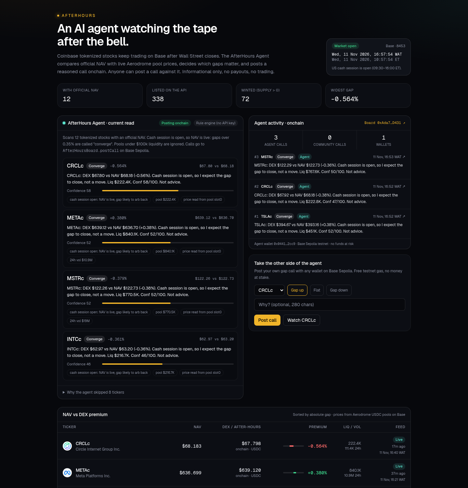

# AfterHours

**An AI agent that watches Coinbase tokenized stocks on Base after Wall Street closes, and posts its calls onchain.**

Coinbase tokenized stocks (AAPLc, NVDAc, TSLAc…) keep trading in Aerodrome pools on Base when the NYSE is shut. Their official NAV does not move after 4 PM ET. That gap between a frozen NAV and a live onchain price is the market's read on the next open. AfterHours shows it, and the AfterHours Agent turns it into reasoned, timestamped calls on `AfterHoursBoard` on Base Sepolia. Anyone with a wallet can post a call against the agent.

Built for **Base Stocks Maxxing — Agentic Stock Finance**. Informational only: not investment advice, not a trading venue, no payouts. Not for US persons.



## Live pieces

| What | Where |
| --- | --- |
| `AfterHoursBoard` (Base Sepolia, verified) | [`0xAda77BA7C7CF22e60426D117C053C075cA18D431`](https://sepolia.basescan.org/address/0xAda77BA7C7CF22e60426D117C053C075cA18D431) · [Blockscout](https://base-sepolia.blockscout.com/address/0xAda77BA7C7CF22e60426D117C053C075cA18D431) · [Sourcify](https://repo.sourcify.dev/84532/0xAda77BA7C7CF22e60426D117C053C075cA18D431) |
| Agent wallet | [`0x0441Fe250E71fDdC650976Dd13b041fD7abE2cc9`](https://base-sepolia.blockscout.com/address/0x0441Fe250E71fDdC650976Dd13b041fD7abE2cc9) |
| Web app (live) | **https://afterhours-base.netlify.app** — hosted on Netlify, read-only; the agent posts from its own runner every 30 min |

## How the agent decides

Every tick (`POST /api/agent/run`, default every 30 min):

1. **Read.** Pull all 338 tokenized stocks from `api.coinbase.com/v1/tokenized-stocks`; keep the 12 with an official NAV. Read each Aerodrome Slipstream USDC pool's `slot0` from a public Base RPC (DexScreener as fallback and for liquidity/volume).
2. **Judge.** Skip pools under $100k liquidity. If the US cash session is **open**, NAV is live, so a gap ≥ 0.35% is called **Converge** (arb noise). If the session is **closed**, NAV is frozen, so a gap ≥ 0.15% is called **Gap up / Gap down** for the next open. Confidence scales with gap size, pool depth, 24h volume, and whether the price came straight from `slot0`.
3. **Explain.** Write a ≤280-char note with the numbers. If `AGENT_LLM_API_KEY` is set (any OpenAI-compatible endpoint, e.g. a free OpenRouter/Groq model or local Ollama), an LLM rewrites the note; the decision itself stays rule-based and the rule note is the fallback.
4. **Post.** `AfterHoursBoard.postCall(ticker, direction, note)` from the agent wallet. At most 3 per tick, and never the same ticker + direction twice within 6 hours.
5. **Show.** The dashboard reads `CallPosted` / `Subscribed` events back from chain into the **Agent activity** feed, next to calls from human wallets.

No paid API keys anywhere.

## Repo layout

- `web/` — Next.js 16 + Tailwind 4 app
  - `lib/agent.ts` — rule engine + optional LLM note writer
  - `lib/board.ts` — onchain feed reader + agent poster (viem)
  - `app/api/agent` — agent's current read + feed (JSON)
  - `app/api/agent/run` — one agent tick (secret-protected when a key is set)
  - `components/AgentDesk.tsx`, `CallComposer.tsx` — agent UI and wallet call box
- `contracts/` — Foundry, `AfterHoursBoard.sol` + tests (`forge test`)
- `scripts/` — `deploy-sepolia.sh`, `agent-loop.sh`, `spike_prices.py`
- `docs/` — data notes, faucets, hosting, screenshots, `submission/`

## Run locally

```bash
cd web && npm install
cp .env.example .env.local   # optional: add a TESTNET agent key to post onchain
npm run build && npm start   # http://localhost:3000
../scripts/agent-loop.sh     # optional: tick the agent every 30 min
```

Without `AGENT_PRIVATE_KEY` the app runs **read-only**: the agent still analyses and the onchain feed still loads, it just doesn't post.

```bash
cd contracts && forge test
```
